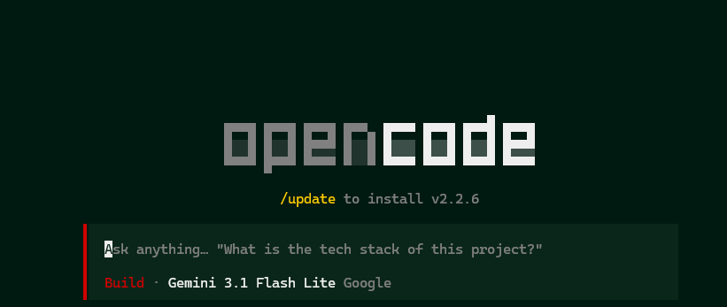
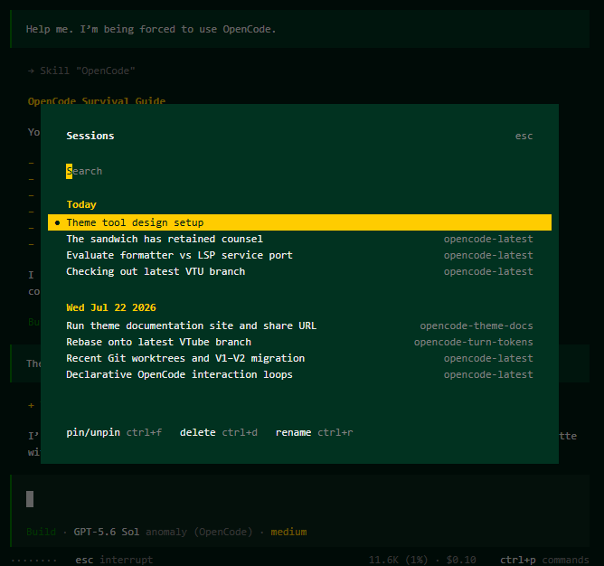
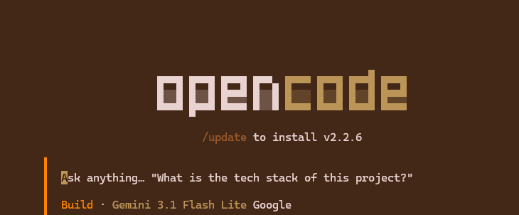
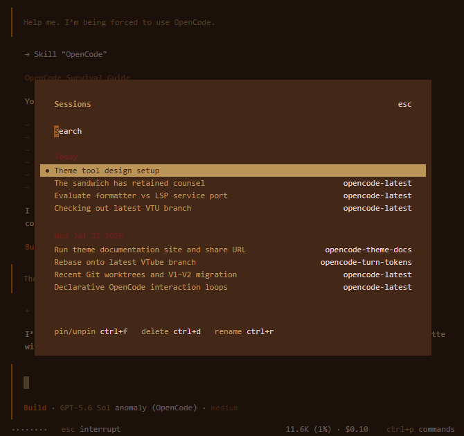

# OpenCode Themes

This repository is a collection of opencode themes that can be used with the opencode TUI.

## Themes

| Theme | Screenshots |
| :--- | :--- |
| **Vamp Christmas** |   |
| **Vamp Thanksgiving** |   |

## Usage 

1. Locate your OpenCode configuration directory. e.g., `~/.config/opencode/themes/`
2. Place the desired `.json` theme file(s) into the `themes` folder within your configuration directory.
3. Restart OpenCode and select the desired theme using `/themes` command

